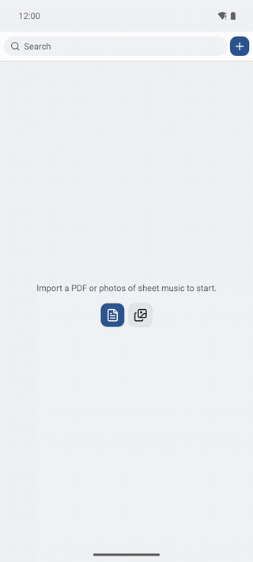
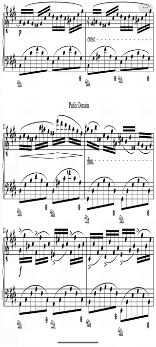
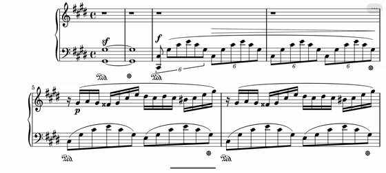
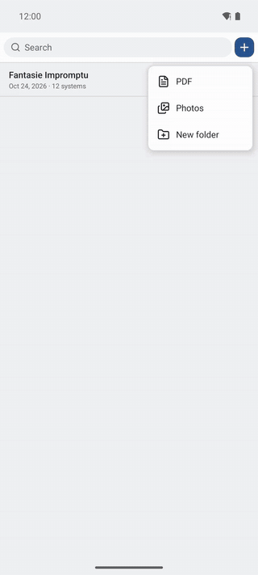

# Rescore

Read piano sheet music on a phone. Rescore takes a PDF, a scan or photos of a score and splits each page into one strip per line of music. It then shows those strips full-width, a few at a time, so the notes stay large enough to read at the piano. Everything runs on the device, with no upload and no server.

<p align="center"></p>

## Features

- **Import:** PDFs (choose which pages to use, reorder them, and bookmark where pieces start) or photos from the gallery.
- **Automatic slicing:** each line of music becomes its own strip. For piano, a line is a *system*: the treble and bass staves joined by a brace, which always stay together.
- **Reader:** full screen. Tap to turn pages (the left third goes back) or swipe right to go back. Swipe up or down, or tap the small `⋯`, for a floating bar that hides itself again. You set how many strips show at once, separately for portrait and landscape, and changing it keeps your place. The reader has a dark mode and keeps the screen awake while you read.
- **Corrections:** in edit mode, merge a strip with the one above, split a strip at movable cut lines with adjustable overlap, or delete a strip to a restorable list of removed systems.
- **Bookmarks:** mark where pieces, movements or passages start, either on whole pages while importing or on any strip in edit mode. Each bookmark starts on a fresh screen, and you can jump to it from the reader or straight from the library.
- **Library:** scores save automatically. Search covers every score, folder and bookmark, and folders can hold other folders.

Slicing isn't always perfect, so strips can be fixed by hand. Here the "Public Domain" footer was sliced together with a system: split it off, then delete the extra piece:

<p align="center"></p>

In landscape the strips get wider, and you can show fewer at a time so the notes are bigger:

<p align="center"></p>

Books with several pieces can go in a folder, with a bookmark where each piece starts (set on pages while importing, or on any strip in edit mode). A bookmark opens straight from the library or from the reader's list:

<p align="center"></p>

## How it works

```text
PDF page / photo
  → rendered to grayscale natively (PdfRenderer on Android, PDFKit on iOS)
  → C++ slicer (shared by both platforms) finds each system's brace, then places strip edges
  → each strip re-rendered from the PDF at up to 2× for sharp text, sharpened and saved
    as a grayscale PNG natively; only file paths and sizes reach JavaScript
  → React Native reader, which resizes each strip to its exact on-screen size
```

The slicer lives in [`modules/piano-pdf-parser/cpp`](modules/piano-pdf-parser/cpp). It binarizes each page, finds the thin vertical brace to the left of each system, and grows a strip around it. Pages without braces fall back to a row-profile method. Strip edges are placed on rows that no ink crosses where possible. Short lines of marks, such as pedal signs, dynamics or tempo words, go with the nearer system. Neighbouring strips overlap on purpose, so notation that crosses a boundary is still readable.

Each strip also keeps its position on the page. The reader uses that to keep indented systems indented, to line up merged strips by their barlines, and to anchor bookmarks so they survive merging, splitting and deleting. Scores, folders and bookmarks are saved on the device, in the app's own storage.

## Results

These were measured with the benchmark in [`cpp/tools/bench`](modules/piano-pdf-parser/cpp/tools/bench). It uses 244 pages from 31 scores, from modern engravings to 19th-century scans.

| | Result |
|---|---|
| Lines of music found correctly (93-page graded set) | 99.3% (408 of 411) |
| Notation at a strip edge still shown whole (landscape view) | 92%, up from 59% before edge snapping |
| Slicer time per page, Galaxy S24 (finding strips only, not rendering or saving images) | about 40 ms (median) |

The benchmark README explains the method, its limits, and how to rerun it.

## Build and run

This app uses a custom native module, so **Expo Go will not work**. You need a development build.

Requirements: Node.js 18+, plus Android Studio for Android or Xcode for iOS. Only the Android build has been tested so far.

```sh
# installs the exact versions in package-lock.json; --force is needed because
# react-dom (pulled in by expo-router) wants a newer react than the app uses
npm ci --force

# development build with Metro
npm run prebuild:dev        # first time only, or to regenerate android/
npx expo run:android
npm start

# release build, installed and launched on your phone
npm run phone

# release APK only, for both phone ABIs (dist/rescore-release.apk)
npm run build:apk

# checks
npm test             # Jest tests for the reader logic in lib/
npm run typecheck
```

Release and development builds share the same `android/` folder (the dev client's tools are left out of release builds automatically), so you can switch between `npm run phone` and Metro freely. `npm run phone` builds only the target device's ABI, so incremental builds take seconds. Adding a native dependency still needs a native rebuild (`npx expo run:android`); reloading Metro isn't enough.

Set `ANDROID_HOME` (usually `~/Android/Sdk`) and put its `platform-tools` first on your `PATH`, so `adb` is the SDK's rather than an older distro package.

### Installing over Wi-Fi

`npm run phone` installs on whichever device is connected, by USB or Wi-Fi. To skip the cable, pair your phone once (Android 11+):

1. On the phone: **Developer options → Wireless debugging → on**, then **Pair device with pairing code**.
2. On the computer: `adb pair <ip>:<pairing port>` and enter the code shown on the phone.

After that, with Wireless debugging on and both devices on the same network, `npm run phone` finds and connects to the phone by itself. If several devices are connected, choose one with `ANDROID_SERIAL=<serial> npm run phone` (`adb devices` lists serials).

### Slicer tests and benchmark

```sh
cd modules/piano-pdf-parser/cpp
cmake -S . -B build -DCMAKE_BUILD_TYPE=Release && cmake --build build
./build/slicer_test

python3 tools/bench/run.py   # needs PyMuPDF and a folder of score PDFs (default ~/Piano)
```

## Picking a PDF on Android

The system picker opens on **Recents**. Use the **☰** menu to reach Downloads or other folders. The internal storage root often looks empty, which is normal. The picker accepts any file type, and the app checks for a PDF itself, because MIME filters can hide files downloaded from IMSLP.

## Project layout

| Path | What's there |
|---|---|
| `app/`, `components/`, `hooks/` | React Native screen, UI components, and hooks for import, paging, autosave, editing and bookmarks |
| `lib/` | Library, folders, bookmarks and corrections logic, with Jest tests in `lib/__tests__` (`npm test`) |
| `modules/piano-pdf-parser/android`, `ios` | Native rendering, PNG encoding and the bridge to the slicer |
| `modules/piano-pdf-parser/cpp` | C++ slicer, unit tests, debug tools and the benchmark |
| `assets/icon-src` | SVG sources for the app icon (`bash build.sh` regenerates the PNGs) |
| `scripts/build-release-apk.mjs` | Release APK build from the shared `android/` folder, and install on a phone (`npm run phone`) |
| `docs/` | The GIFs in this README, recorded on an Android emulator (tap markers added afterwards) |
